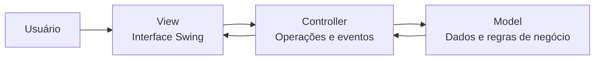

# Trabalho-ControleFinanceiro


# Sistema de Controle Financeiro Pessoal

**Disciplina:** Elicitação e Programação

**Professor:** Hudson Neves


**Curso:** Engenharia de Software — 2º semestre

**Projeto:** Grupo 04 — Controle Financeiro Pessoal

## Integrantes e Matrícula


- Danilo Marques de Sousa – 0028249
- Israel Roberto Pinheiro – 0026780
- Jefter Samuel Rocha Alves – 0028515
- João Gabriel Lopes Liborio – 0027035
- Matheus Henrique Brito de Jesus – 0026897
- Nathan de Aguiar Carvalho Leite – 0026776

---


<div align="center"> Controle Financeiro Pessoal
Organização financeira com Java Swing e arquitetura MVC
Trabalho acadêmico · Grupo 04 · Engenharia de Software

Uma aplicação desktop para registrar movimentações, acompanhar receitas e despesas e visualizar o saldo pessoal.
</div> Sobre o projeto
O Controle Financeiro Pessoal é um projeto acadêmico da disciplina Elicitação e Programação, desenvolvido pelo Grupo 04 do segundo semestre de Engenharia de Software, sob orientação do professor Hudson Neves.

A proposta consiste em construir um sistema desktop em Java SE, com interface gráfica em Swing, capaz de organizar as finanças de um usuário. O sistema deve permitir o registro e a consulta de receitas e despesas, a edição e exclusão de movimentações e a geração de um resumo financeiro.

A organização do código segue o padrão MVC (Model–View–Controller), separando dados e regras de negócio, componentes visuais e coordenação das operações. Os registros são mantidos em memória por meio de arrays ou ArrayList, sem banco de dados.
Escopo acadêmico: as funcionalidades e a estrutura descritas abaixo correspondem aos requisitos do projeto. Sua implementação deve ser verificada no código-fonte do repositório.

 Funcionalidades previstas
Funcionalidade	Descrição
 Cadastro de receitas	Registrar descrição, valor e data de recebimento.
 Cadastro de despesas	Registrar descrição, valor, data e categoria.
 Listagem de movimentações	Exibir receitas e despesas em uma tabela JTable.
 Pesquisa e filtros	Consultar movimentações por tipo ou categoria.
 Edição e exclusão	Alterar ou remover lançamentos existentes.
 Cálculo automático	Apurar total de receitas, total de despesas e saldo.
 Relatório financeiro	Apresentar os totais e a categoria com maior volume de despesas.

Regras de negócio
- Não permitir receitas ou despesas com valor menor ou igual a zero.
- Validar os dados informados antes de registrar ou atualizar uma movimentação.
- Recalcular receitas, despesas e saldo após cadastros, edições e exclusões.
- Manter os registros acessíveis durante toda a execução, mesmo ao fechar e reabrir uma tela.
- Armazenar informações somente em memória: os dados não persistem após o encerramento do programa.
 Interface gráfica
A interface deve ser construída exclusivamente com Java Swing e conter, no mínimo, as seguintes telas:
1. Tela principal: identificação do sistema e acesso às funções.
2. Cadastro de movimentações: formulário de registro de receitas e despesas.
3. Consulta financeira: tabela com lançamentos, pesquisas e filtros.
4. Relatório financeiro: apresentação dos resultados e totais calculados.
Entre os componentes previstos estão JFrame, JPanel, JTextField, JButton, JTable, JComboBox e JOptionPane, com mensagens de validação, confirmação e erro.
    Arquitetura MVC
O projeto utiliza a separação de responsabilidades para facilitar o entendimento, a manutenção e a evolução do código.

- Model: representa as movimentações financeiras, mantém as coleções em memória e aplica validações e cálculos.
- View: apresenta telas, formulários, tabelas e mensagens, além de receber as ações do usuário.
- Controller: recebe os eventos da interface, coordena as operações e estabelece a comunicação entre View e Model.
   Estrutura sugerida do projeto
A estrutura abaixo é uma referência de organização, a ser ajustada aos nomes reais das classes implementadas.


## Estrutura do Projeto

O projeto está organizado em pacotes seguindo o padrão MVC:

```text
src/
├── app/
│   └── Main.java
│
├── model/
│   ├── Movimentacao.java
│   └── Financeiro.java
│
├── controller/
│   └── FinanceiroController.java
│
└── view/
    ├── TelaPrincipal.java
    ├── TelaCadastro.java
    ├── TelaConsulta.java
    ├── TelaRelatorio.java
    ├── GraficoFinanceiro.java
    └── Estilo.java
```


    
 ## Tecnologias Utilizadas

| Tecnologia | Aplicação |
|---|---|
| Java SE 21 | Linguagem de programação |
| Java Swing | Interface gráfica |
| Eclipse IDE | Ambiente de desenvolvimento |
| ArrayList | Armazenamento em memória |
| Java Time API | Manipulação de datas e horários |
| MVC | Organização arquitetural |

**Restrições da atividade:**
- não utilizar banco de dados
- aplicações web
- Spring Boot 
- JavaFX ou frameworks externos
- A interação principal do sistema deve ocorrer pela interface gráfica, não pelo terminal.

---

 Como executar
1. Instale um JDK compatível com a versão utilizada no projeto.
2. Clone ou baixe este repositório.
3. Importe o projeto em uma IDE Java, como o Eclipse.
4. Configure o JDK e confira a organização das pastas de código-fonte.
5. Localize a classe que contém o método public static void main(String[] args).
6. Execute a classe principal como Java Application.
7. Utilize as opções disponíveis na interface gráfica.
Observação: o nome exato da classe de inicialização e a versão do JDK devem ser confirmados no código final.

 Objetivos de aprendizagem
O desenvolvimento deste projeto tem como finalidade aplicar, em um problema prático, conhecimentos de Java, estruturas condicionais e de repetição, métodos, classes, objetos, encapsulamento, coleções, tratamento de entradas inválidas e eventos de interface. Também busca exercitar a organização do código em MVC e a implementação de operações de cadastro, consulta, atualização, exclusão e cálculos financeiros.

<div align="center">Controle Financeiro Pessoal · Grupo 04

Projeto acadêmico desenvolvido para aplicação dos fundamentos de programação e desenvolvimento desktop em Java.
</div>
